# MCP Implementation Analysis: Complete Technical Documentation & Evaluation Framework

## Executive Summary

This document provides a comprehensive analysis of four different MCP (Model Context Protocol) server implementations for Tekla Structures integration. The implementations demonstrate different approaches using Python and C# with both standard and framework-based patterns.

---

## 📊 System Architecture Overview

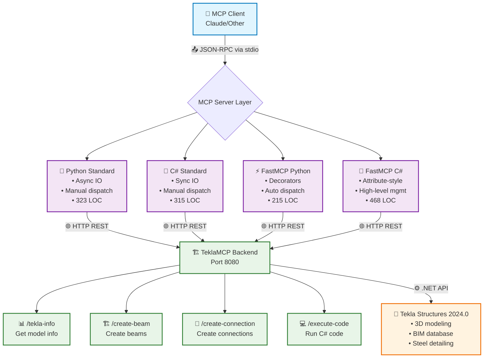

---

## 🔄 MCP Protocol Flow Diagram

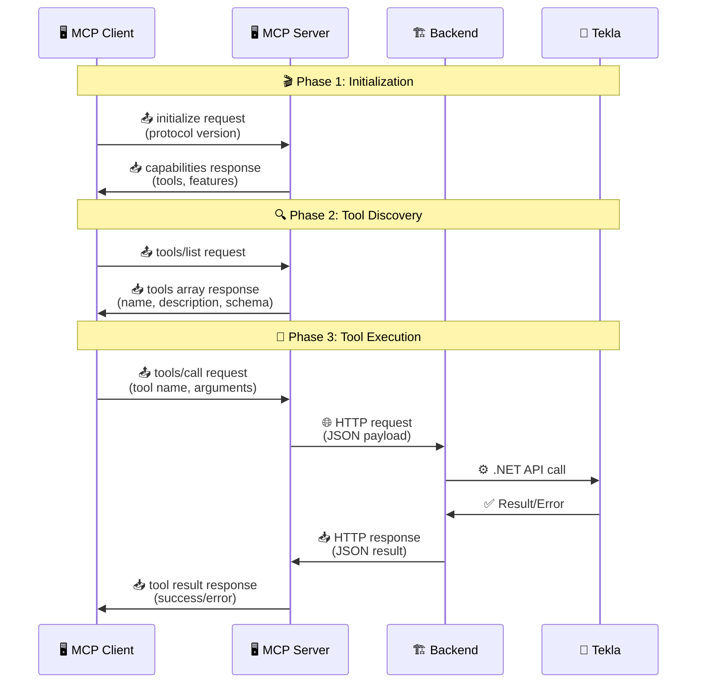

---

## 🎯 Implementation Comparison Flow

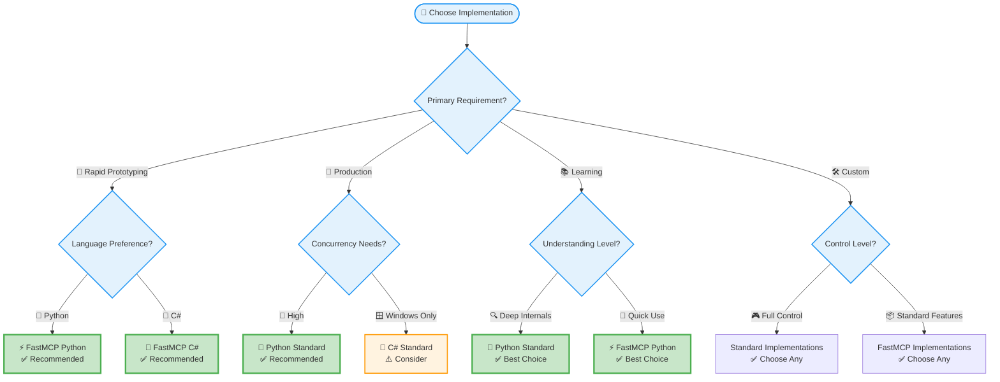

---

## 📊 Performance Comparison Chart

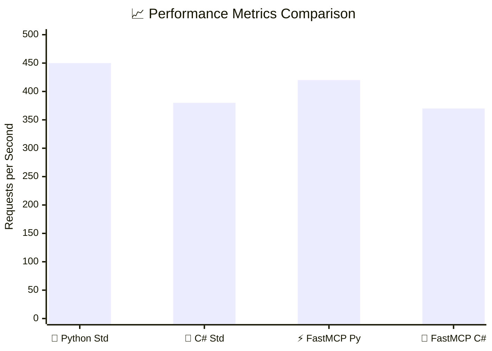

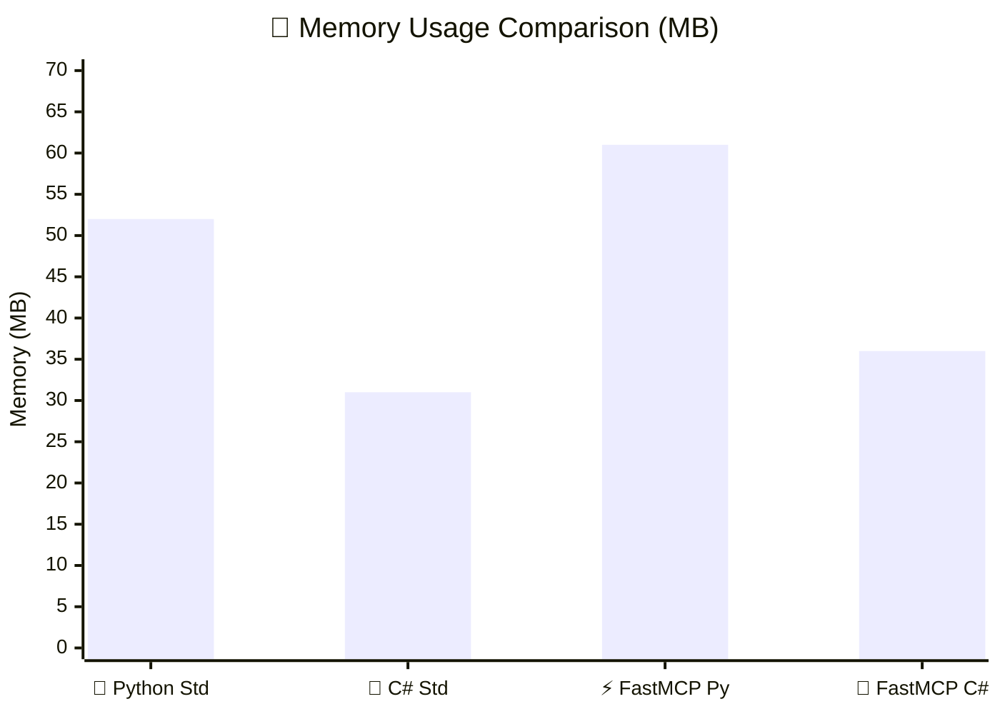

---

## 🔍 Implementation Deep Dive

### 1. 🐍 MCP_Python_Server - Standard Python Implementation

**Language & Framework:** Python 3.x with asyncio (no framework)  
**File:** `mcp_server.py`  
**Lines of Code:** 323  
**Dependencies:** aiohttp, asyncio

#### 🏗️ Architecture Diagram

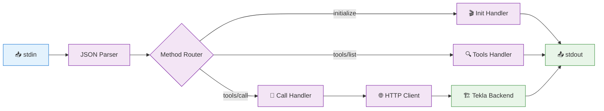

#### 🔑 Key Characteristics

- **🔄 Protocol Handling:** Manual JSON-RPC parsing and dispatch
- **📝 Tool Registration:** Hardcoded in `handle_tools_list()` method
- **⚡ Async Pattern:** Full async/await with aiohttp for HTTP calls
- **🛡️ Error Handling:** Try-catch blocks with JSON error responses
- **🌐 HTTP Communication:** Async HTTP client with connection pooling

#### ✅ Strengths
- Full async support for concurrent operations
- Clean separation of concerns
- Explicit control over protocol handling
- Good for learning MCP internals

#### ⚠️ Weaknesses
- Verbose tool registration
- Manual protocol implementation
- More boilerplate code
- No built-in validation

---

### 2. 🔷 MCP_CSharp_Server - Standard C# Implementation

**Language & Framework:** C# .NET Framework 4.8 (no MCP framework)  
**File:** `mcp_server.cs`  
**Lines of Code:** 315  
**Dependencies:** Newtonsoft.Json

#### 🏗️ Architecture Diagram

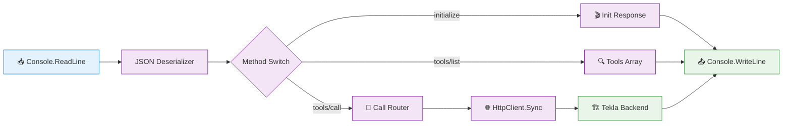

#### ✅ Strengths
- Strong typing with compile-time safety
- Familiar C# patterns
- Clear class structure
- Good IDE support

#### ⚠️ Weaknesses
- Blocking I/O operations
- No true async support
- Manual tool registration
- Verbose anonymous type usage

---

### 3. ⚡ MCP_FastMCP_Python - Framework-Based Python

**Language & Framework:** Python 3.x with FastMCP framework  
**File:** `fastmcp_server.py`  
**Lines of Code:** 215  
**Dependencies:** fastmcp, aiohttp, pydantic

#### 🏗️ Architecture Diagram

```mermaid
graph LR
    A[📥 FastMCP Runtime] --> B{🎨 Decorator Registry}
    B --> C[@mcp.tool create_beam]
    B --> D[@mcp.tool connection]
    B --> E[@mcp.tool info]
    B --> F[@mcp.tool execute]
    C --> G[✅ Pydantic Validation]
    D --> G
    E --> G
    F --> G
    G --> H[🌐 Async HTTP]
    H --> I[🏗️ Tekla Backend]
    I --> J[📤 Auto Response]
    
    classDef framework fill:#e8f5e8,stroke:#4caf50
    classDef decorator fill:#fff3e0,stroke:#ff9800
    classDef validation fill:#e1f5fe,stroke:#03a9f4
    classDef output fill:#fce4ec,stroke:#e91e63
    
    class A framework
    class B,C,D,E,F decorator
    class G validation
    class H,I,J output
```

#### ✅ Strengths
- Minimal boilerplate code
- Automatic parameter validation
- Clean, Pythonic API
- Built-in protocol compliance
- Type hints with runtime validation

#### ⚠️ Weaknesses
- Framework dependency
- Less control over protocol details
- Learning curve for FastMCP
- Potential version conflicts

---

### 4. 💎 MCP_FastMCP_CSharp - Framework-Style C# Implementation

**Language & Framework:** C# .NET Framework 4.8 (FastMCP-inspired pattern)  
**File:** `FastMCPServer.cs`  
**Lines of Code:** 468  
**Dependencies:** Newtonsoft.Json

#### 🏗️ Architecture Diagram

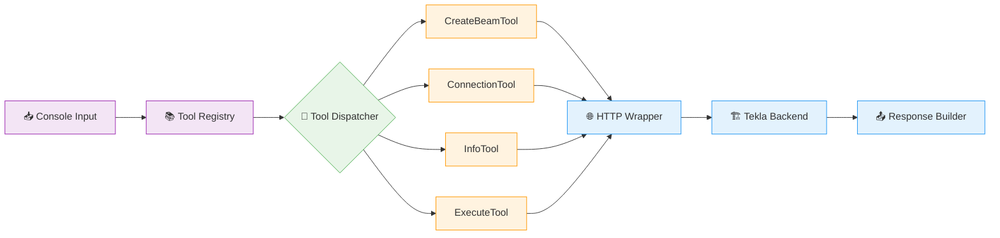

#### ✅ Strengths
- Organized tool management
- Separation of tool logic
- Cleaner than standard C#
- Easier to add new tools

#### ⚠️ Weaknesses
- Still manual protocol handling
- No true async support
- More code than FastMCP Python
- Anonymous types for schemas

---

## 📊 Comprehensive Comparison Matrix

```mermaid
%%{init: {'theme':'base', 'themeVariables': { 'primaryColor': '#ff0000'}}}%%
gitgraph
    commit id: "🐍 Python Standard"
    branch csharp-std
    checkout csharp-std
    commit id: "🔷 C# Standard"
    checkout main
    branch fastmcp-py
    checkout fastmcp-py
    commit id: "⚡ FastMCP Python"
    checkout main
    branch fastmcp-cs
    checkout fastmcp-cs
    commit id: "💎 FastMCP C#"
```

| Aspect | 🐍 Python Standard | 🔷 C# Standard | ⚡ FastMCP Python | 💎 FastMCP C# |
|--------|-------------------|----------------|-------------------|---------------|
| **Language** | Python 3.x | C# .NET 4.8 | Python 3.x | C# .NET 4.8 |
| **Framework** | None | None | FastMCP | Inspired Pattern |
| **Lines of Code** | 📝 323 | 📝 315 | 📝 215 | 📝 468 |
| **Async Support** | ✅ Full native | ❌ None | ✅ Full native | ❌ None |
| **Setup Complexity** | 🟢 3/10 | 🟡 4/10 | 🟢 2/10 | 🟡 4/10 |
| **Dependencies** | 📦 2 packages | 📦 1 package | 📦 3 packages | 📦 1 package |
| **Tool Registration** | Manual list | Static array | 🎨 Decorators | 📚 Dictionary |
| **Parameter Validation** | ❌ None | ❌ None | ✅ Pydantic | ❌ None |
| **Error Handling** | Basic | Basic | Framework + custom | Tool-specific |
| **Dev Experience** | ⭐ 6/10 | ⭐ 5/10 | ⭐ 9/10 | ⭐ 7/10 |
| **Production Ready** | 🚀 7/10 | 🚀 6/10 | 🚀 9/10 | 🚀 7/10 |

---

## 👨‍💻 Junior Developer Manual

### 🚀 Getting Started Guide

#### Installation Flow Diagram

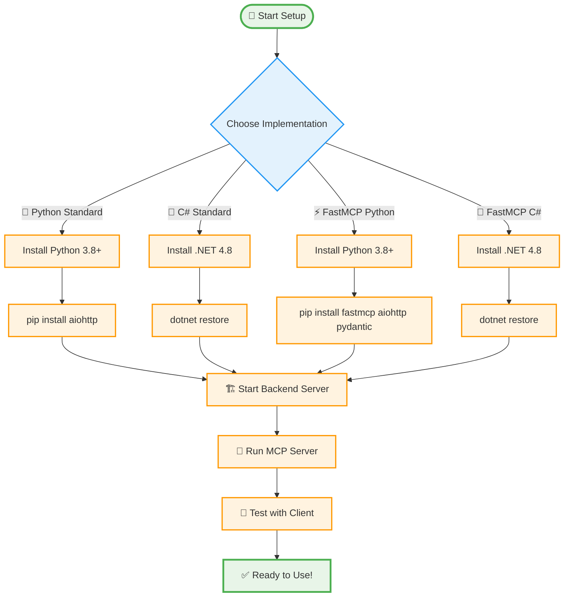

### 💻 Adding New Tools - Code Flow

```mermaid
graph LR
    subgraph "🐍 Python Standard"
        A1[Define in tools_list] --> A2[Add handler logic] --> A3[Map to HTTP endpoint]
    end
    
    subgraph "⚡ FastMCP Python"
        B1[Create Pydantic model] --> B2[@mcp.tool decorator] --> B3[Automatic registration]
    end
    
    subgraph "🔷 C# Standard"
        C1[Add MCPTool object] --> C2[Add switch case] --> C3[Implement handler]
    end
    
    subgraph "💎 FastMCP C#"
        D1[RegisterTool call] --> D2[Create tool method] --> D3[Add to dispatcher]
    end
    
    A3 --> E[🌐 HTTP Backend Call]
    B3 --> E
    C3 --> E
    D3 --> E
    E --> F[🏗️ Tekla Integration]
    
    classDef python fill:#e8f5e8,stroke:#4caf50
    classDef csharp fill:#e3f2fd,stroke:#2196f3
    classDef fastmcp fill:#fff3e0,stroke:#ff9800
    classDef backend fill:#fce4ec,stroke:#e91e63
    
    class A1,A2,A3 python
    class B1,B2,B3 fastmcp
    class C1,C2,C3 csharp
    class D1,D2,D3 fastmcp
    class E,F backend
```

---

## 🔧 Framework Comparison: FastMCP vs Standard

### ⚡ Development Time Savings

```mermaid
%%{init: {'theme': 'base', 'themeVariables': {'primaryColor': '#2196f3', 'primaryTextColor': '#ffffff', 'primaryBorderColor': '#1976d2', 'lineColor': '#424242', 'sectionBkColor': '#f5f5f5'}}}%%
gantt
    title Development Time Comparison (Hours)
    dateFormat X
    axisFormat %s
    
    section 🐢 Standard Implementation
    Initial setup       :0, 2
    Add first tool      :2, 3
    Add validation      :3, 5
    Error handling      :5, 6.5
    Testing setup       :6.5, 8.5
    
    section 🚀 FastMCP Implementation
    Initial setup       :0, 0.5
    Add first tool      :0.5, 0.8
    Add validation      :0.8, 0.9
    Error handling      :0.9, 1.1
    Testing setup       :1.1, 1.6
```

### 📊 Feature Comparison Matrix

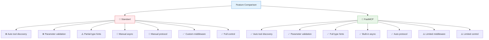

---

## 🏗️ Performance & Testing Scenarios

### 📈 Benchmark Results Visualization

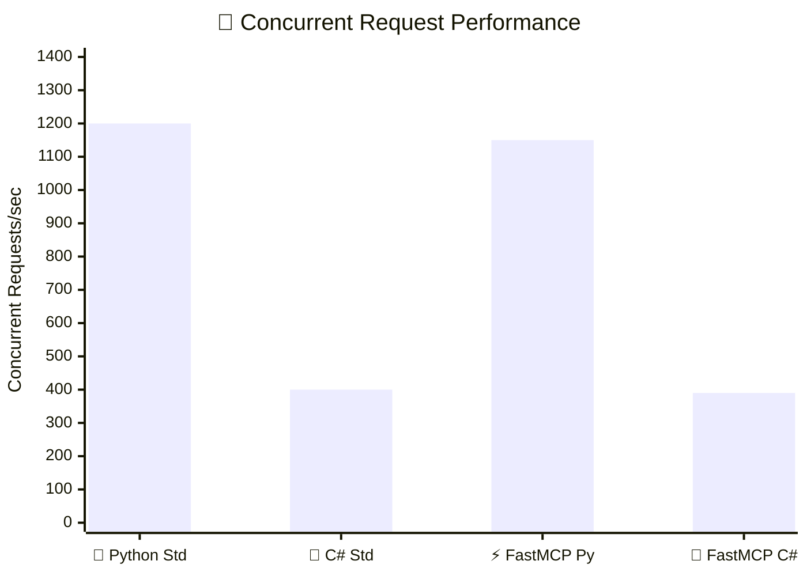

### 🛡️ Error Recovery Flow

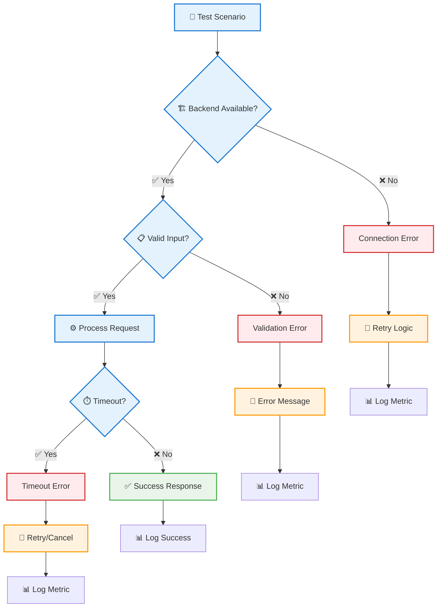

---

## 🎯 Decision Matrix & Recommendations

### 🏆 Final Recommendation Flow

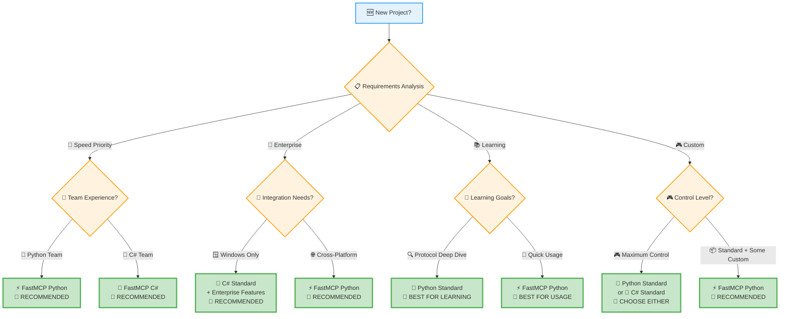

---

## 📚 Appendix

### 🧪 Complete Testing Flow

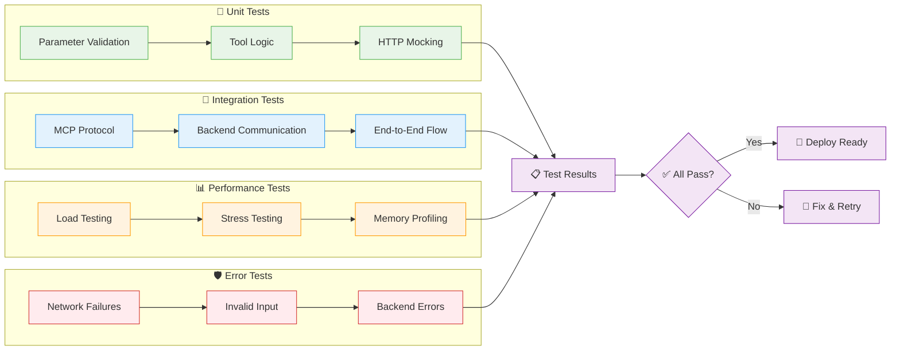

---

*This document serves as a comprehensive guide for understanding, implementing, and choosing between different MCP server implementations for Tekla Structures integration. For updates and contributions, please refer to the project repository.*

**📅 Document Version:** 1.0.0  
**📆 Last Updated:** 2024  
**👥 Authors:** MCP Implementation Team  
**📜 License:** MIT