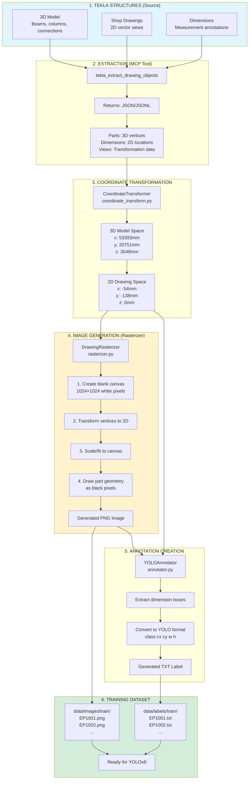

# VirtualDetailer ML - Complete Data Flow Explained
## Where Do the Images Come From?

**Quick Answer:** We **generate** them from Tekla's vector geometry using a rasterizer.

---

## The Full Pipeline



---

## Detailed Step-by-Step

### Step 1: Tekla Extraction

**Tool:** `tekla_extract_drawing_objects(drawing_mark="EP1001")`

**What it extracts:**
```json
{
  "mark": "[EP1001]",
  "drawing_type": "AssemblyDrawing",
  "views": [
    {
      "coordinate_system_3d": {
        "origin": {"x": 53393.2, "y": 20751.4, "z": 3048.9},
        "axis_x": {"x": 1.0, "y": 0.0, "z": 0.0},
        "axis_y": {"x": 0.0, "y": 1.0, "z": 0.0}
      }
    }
  ],
  "objects": [
    {
      "type_name": "Part",
      "tekla_id": 12345,
      "geometric_data": {
        "vertices": [
          {"x": 53393.2, "y": 20751.4, "z": 3048.9},
          {"x": 53545.6, "y": 20751.4, "z": 3048.9},
          {"x": 53545.6, "y": 20853.0, "z": 3048.9},
          {"x": 53393.2, "y": 20853.0, "z": 3048.9}
        ]
      }
    },
    {
      "type_name": "StraightDimension",
      "properties": {
        "StartPoint": "(-54.372, -138.113, 0.000)",
        "EndPoint": "(-54.372, -36.513, 0.000)"
      }
    }
  ]
}
```

**File saved to:** `Server/TeklaMCP/extractions/tekla_extraction_ml_20251220_FINAL.jsonl`

**Key Point:** This is **VECTOR DATA**, not images!

---

### Step 2: Coordinate Transformation (3D → 2D)

**Problem:** Parts have 3D coordinates, dimensions have 2D coordinates

**File:** `src/coordinate_transform.py`

**What it does:**
```python
class CoordinateTransformer:
    def __init__(self, view):
        # Extract 3D coordinate system from view
        self.origin_3d = (53393.2, 20751.4, 3048.9)
        self.axis_x = (1.0, 0.0, 0.0)
        self.axis_y = (0.0, 1.0, 0.0)

    def transform_3d_to_2d(self, point_3d):
        # Translate point to view origin
        p_relative = point_3d - origin_3d

        # Project onto 2D view plane using dot product
        x_2d = dot(p_relative, axis_x)
        y_2d = dot(p_relative, axis_y)

        return (x_2d, y_2d)
```

**Example transformation:**
```
3D Point: (53545.6, 20751.4, 3048.9)
   ↓
2D Point: (152.4, 0.0)
```

**Why critical:** Without this, parts and dimensions are in different coordinate systems → 0 valid annotations

---

### Step 3: Rasterization (Vector → Pixels) ⭐ IMAGE CREATION

**File:** `src/rasterizer.py`

**What it does:** **Creates PNG images from scratch**

#### Process:

**3a. Create Blank Canvas**
```python
# 1024×1024 white canvas
image = np.ones((1024, 1024, 3), dtype=np.uint8) * 255

# Result: All white image
┌─────────────────┐
│░░░░░░░░░░░░░░░░░│
│░░░░░░░░░░░░░░░░░│
│░░░░░░░░░░░░░░░░░│  ← Every pixel is white (255, 255, 255)
│░░░░░░░░░░░░░░░░░│
└─────────────────┘
```

**3b. Transform Vertices to 2D**
```python
# Use CoordinateTransformer on each vertex
vertices_2d = []
for vertex_3d in part['vertices']:
    x_2d, y_2d = transformer.transform_3d_to_2d(vertex_3d)
    vertices_2d.append((x_2d, y_2d))

# Example result:
# vertices_2d = [(0, 0), (152.4, 0), (152.4, 101.6), (0, 101.6)]
```

**3c. Calculate Bounds and Scale**
```python
# Find min/max to fit drawing in image
min_x = min(v[0] for v in all_vertices)  # -500
max_x = max(v[0] for v in all_vertices)  # +500
min_y = min(v[1] for v in all_vertices)  # -300
max_y = max(v[1] for v in all_vertices)  # +300

# Calculate scale to fit in 924 pixels (1024 - 2*50 margin)
width_mm = max_x - min_x   # 1000mm
height_mm = max_y - min_y  # 600mm

scale = 924 / max(width_mm, height_mm)  # 0.924 pixels/mm

# Calculate offset to center drawing
offset_x = 50 + (924 - width_mm * scale) / 2
offset_y = 50 + (924 - height_mm * scale) / 2
```

**3d. Draw Part Geometry**
```python
# Convert each vertex to pixel coordinates
pixel_points = []
for x_mm, y_mm in vertices_2d:
    pixel_x = int((x_mm - min_x) * scale + offset_x)
    pixel_y = int((y_mm - min_y) * scale + offset_y)
    pixel_points.append((pixel_x, pixel_y))

# Draw filled polygon on canvas
cv2.fillPoly(image, [np.array(pixel_points)], (0, 0, 0))

# Result: Black beam on white background
┌─────────────────┐
│░░░░░░░░░░░░░░░░░│
│░░░░███████░░░░░░│ ← Beam rendered as black pixels
│░░░░███████░░░░░░│
│░░░░███████░░░░░░│
│░░░░░░░░░░░░░░░░░│
└─────────────────┘
```

**3e. Save as PNG**
```python
cv2.imwrite('data/images/train/EP1001.png', image)
```

**Output:** `EP1001.png` - A real PNG image file (1024×1024 pixels)

---

### Step 4: Annotation Generation

**File:** `src/annotator.py`

**What it does:** Creates YOLO format text labels

```python
# For each dimension in the drawing:
# 1. Parse dimension location from properties
start_point = parse_point("(-54.372, -138.113, 0.000)")  # Already in 2D
end_point = parse_point("(-54.372, -36.513, 0.000)")

# 2. Create bounding box around dimension
min_x = min(start_point[0], end_point[0]) - padding
max_x = max(start_point[0], end_point[0]) + padding
min_y = min(start_point[1], end_point[1]) - padding
max_y = max(start_point[1], end_point[1]) + padding

# 3. Convert to pixel coordinates (using same scale/offset from rasterizer)
pixel_min_x = int((min_x - drawing_min_x) * scale + offset_x)
pixel_min_y = int((min_y - drawing_min_y) * scale + offset_y)
pixel_max_x = int((max_x - drawing_min_x) * scale + offset_x)
pixel_max_y = int((max_y - drawing_min_y) * scale + offset_y)

# 4. Convert to YOLO format (normalized 0-1)
center_x = (pixel_min_x + pixel_max_x) / 2 / 1024
center_y = (pixel_min_y + pixel_max_y) / 2 / 1024
width = (pixel_max_x - pixel_min_x) / 1024
height = (pixel_max_y - pixel_min_y) / 1024

# 5. Write to label file
label = f"0 {center_x:.6f} {center_y:.6f} {width:.6f} {height:.6f}"
```

**Output:** `EP1001.txt`
```
0 0.423456 0.315678 0.152345 0.248678
0 0.678901 0.523456 0.140123 0.223456
```

---

### Step 5: Training Dataset

**Result:** Paired image + label files

```
data/
├── images/
│   └── train/
│       ├── EP1001.png  ← 1024×1024 PNG (generated from vectors)
│       ├── EP1002.png
│       └── ...
└── labels/
    └── train/
        ├── EP1001.txt  ← YOLO format annotations
        ├── EP1002.txt
        └── ...
```

**YOLOv8 can now train on these files!**

---

## Key Insights

### 1. Images Are **Generated**, Not Extracted

**NOT:** Screenshot from Tekla
**NOT:** Exported from Tekla as image
**YES:** Programmatically rendered from vector data using OpenCV

### 2. Why Generate Images?

| Approach | Pros | Cons |
|----------|------|------|
| **Screenshot from Tekla** | Easy | Inconsistent, includes UI, low resolution |
| **Export as DXF/DWG** | Standard format | Still vector, YOLO can't use |
| **Rasterize programmatically** ✅ | Consistent, clean, controllable | Requires coordinate transformation |

### 3. The Critical Coordinate Transformation

**Without transformation:**
```
Part vertices:     (53393mm, 20751mm)  ← 3D model space
Dimension location:   (-54mm, -138mm)  ← 2D drawing space
Result: MISALIGNED → 0 annotations
```

**With transformation:**
```
Part vertices → Transform → (152mm, 0mm)  ← 2D drawing space
Dimension location:         (-54mm, -138mm)  ← 2D drawing space
Result: ALIGNED → 878 valid annotations ✅
```

### 4. Why 1024×1024?

**Reasons:**
- Power of 2 (efficient for CNNs)
- Standard for YOLOv8 (also supports 640, 1280)
- Large enough for detail
- Small enough for fast training
- Fits in GPU memory easily

---

## Alternative: Could We Use Vector Data Directly?

**Theoretically: YES**

**Would require:**
1. **Graph Neural Network (GNN)** instead of CNN
   - Nodes = parts/dimensions
   - Edges = spatial relationships

2. **Geometric Deep Learning**
   - Process CAD geometry natively
   - No rasterization needed

3. **Custom architecture**
   - Build from scratch
   - No pre-trained weights
   - Much more complex

**Why we chose rasterization:**
- ✅ Leverage YOLOv8 (proven, mature)
- ✅ Transfer learning from COCO (319/355 weights)
- ✅ Fast training (16 minutes for baseline)
- ✅ Well-understood pipeline
- ✅ Abundant resources and documentation

---

## Summary: Image Generation Pipeline

```
Tekla Vector Data
      ↓
Extract (MCP)
      ↓
Transform Coordinates (3D → 2D)
      ↓
Rasterize to Pixels (Vector → Image)  ← IMAGES CREATED HERE
      ↓
Generate YOLO Annotations
      ↓
Training Dataset (PNG + TXT)
      ↓
YOLOv8 Training
```

**Bottom Line:** We **create** the images from Tekla's vector geometry because YOLOv8 is a computer vision model that only understands pixels, not CAD vectors.

---

**Generated:** 2025-12-26
**Related Files:**
- `src/rasterizer.py` - Image generation code
- `src/coordinate_transform.py` - 3D→2D transformation
- `src/generate_dataset.py` - Complete pipeline orchestration
