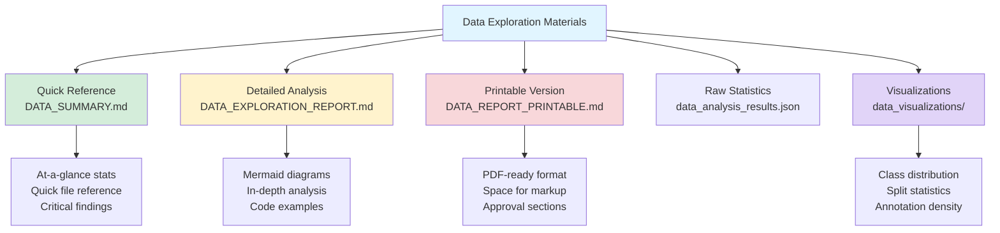
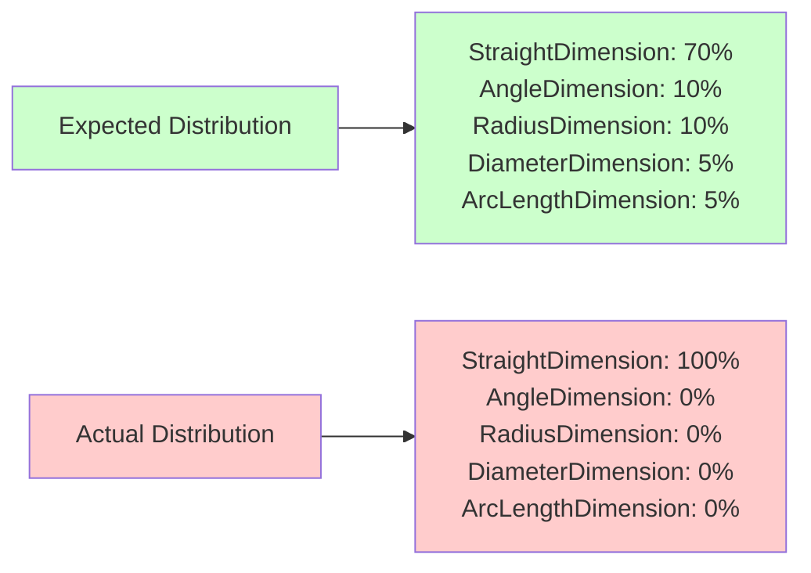

# 📊 Data Exploration Guide - Start Here!

**Purpose:** Comprehensive guide to understanding the VirtualDetailer ML training dataset

**Date Created:** 2025-12-21

---

## 🎯 What You Have

I've created **4 comprehensive documents** + **3 visualizations** explaining every aspect of your training data:



---

## 📚 Which Document Should You Read?

### 🏃 **Need quick stats?** → `DATA_SUMMARY.md`
**Best for:** Quick reference, checking specific numbers, understanding critical issues

**Time to read:** 5 minutes

**Contains:**
- Dataset statistics table
- Critical findings highlight
- File structure reference
- Visualization index
- Quick action items

**Use when:**
- "How many training images do we have?"
- "What's the class distribution?"
- "Where are the visualizations?"

---

### 🔬 **Want deep technical understanding?** → `DATA_EXPLORATION_REPORT.md`
**Best for:** Understanding data structure, pipeline architecture, technical decisions

**Time to read:** 20-30 minutes

**Contains:**
- Complete data pipeline with Mermaid diagrams
- Coordinate transformation explanation (3D→2D)
- Detailed class distribution analysis
- Bounding box geometric analysis
- Sample data exploration
- Code examples from pipeline

**Use when:**
- "How does the 3D→2D transformation work?"
- "Why do we have only StraightDimension?"
- "What's the typical dimension size?"
- Understanding for technical discussions

---

### 📄 **Need to review with team?** → `DATA_REPORT_PRINTABLE.md`
**Best for:** Team review, markup, approval process, PDF export

**Time to read:** 15 minutes + markup time

**Contains:**
- Checkboxes for verification
- Space for handwritten notes
- Action item tracking
- Approval sign-off sections
- Structured for printing

**Use when:**
- Team review meetings
- Data quality certification
- Creating annotated PDF for records
- Tracking action items and owners

---

### 💾 **Need raw data?** → `data_analysis_results.json`
**Best for:** Programmatic access, custom analysis, integration with other tools

**Format:** JSON

**Contains:**
- All statistics in machine-readable format
- Split statistics
- Class distribution counts
- Annotation quality metrics
- Bounding box statistics

**Use when:**
- Building dashboards
- Custom reporting
- Automated quality checks
- Integration with MLOps tools

---

## 🖼️ Visualizations Explained

### 📊 All visualizations located in: `data_visualizations/`

#### 1. `class_distribution.png` - Dimension Type Pie Chart
```
┌─────────────────────────────┐
│   Dimension Distribution    │
├─────────────────────────────┤
│                             │
│    █████████████████        │  ← 100% StraightDimension
│   ███████████████████       │     (should be ~70%)
│  █████████████████████      │
│   ███████████████████       │  ← Missing: Angle, Radius,
│    █████████████████        │     Diameter, ArcLength
│                             │
└─────────────────────────────┘
```

**What it shows:** Severe class imbalance
**Key insight:** Model can only learn straight dimensions
**Action:** Fix dimension type classification

#### 2. `split_statistics.png` - Train/Val/Test Distribution
```
┌─────────────────────┬─────────────────────┐
│   Images per Split  │ Annotations per Split│
├─────────────────────┼─────────────────────┤
│        70│          │       700│           │
│        60│    62    │       600│    631    │
│        50│          │       500│           │
│        40│   ███    │       400│   ███     │
│        30│   ███    │       300│   ███     │
│        20│   ███ 14 │       200│   ███ 138 │
│        10│   ███ ███│       100│   ███ ███ │
│         0│   ███ ███│         0│   ███ ███ │
│          └───────────        └────────────  │
│           Train Val Test      Train Val Test│
└─────────────────────┴─────────────────────┘
```

**What it shows:** Balanced data splitting
**Key insight:** Training set has 71.9% of data (good)
**Action:** No changes needed

#### 3. `annotations_distribution.png` - Complexity Histogram
```
┌─────────────────────────────────────┐
│ Annotations per Image Distribution   │
├─────────────────────────────────────┤
│                                      │
│ 35│                                  │
│ 30│              ███                 │  ← Peak: 10-15 dimensions
│ 25│              ███                 │     (33 images, 36.7%)
│ 20│          ███ ███                 │
│ 15│      ███ ███ ███ ███             │
│ 10│  ███ ███ ███ ███ ███             │
│  5│  ███ ███ ███ ███ ███ ███ ███    │
│  0└────────────────────────────────  │
│    0-1 1-5 5-10 10-15 15-20 20-30   │
└─────────────────────────────────────┘
       Mean: 9.8 | Median: 11.0
```

**What it shows:** Most drawings have 10-15 dimensions
**Key insight:** Good density for training (not too sparse, not too dense)
**Action:** Remove 7 images with 0 annotations

---

## 🔍 Critical Finding: Class Imbalance

### The Problem

**100% of all 878 annotations are classified as StraightDimension**



### Why It Matters

**Impact on Model:**
- Can ONLY detect straight dimensions
- Cannot learn angle, radius, diameter, or arc length dimensions
- Severely limits practical applicability

**Real-World Consequence:**
- Model deployed to production would miss 30% of dimensions
- No value for complex assemblies with angles/arcs
- Requires manual dimension placement for non-straight types

### Where to Investigate

**File:** `VirtualDetailer_ML/src/annotator.py`

**Function:** `_classify_dimension_type()`

```python
# Current logic (suspected issue):
def _classify_dimension_type(self, dimension_obj: Dict) -> int:
    type_name = dimension_obj.get('type_name', '')

    if 'Straight' in type_name:
        return 0  # StraightDimension
    elif 'Angle' in type_name:
        return 1  # AngleDimension
    # ... other types ...

    return 0  # DEFAULT - might be catching everything
```

**Potential Root Causes:**
1. All dimensions defaulting to class 0
2. `type_name` field not properly populated
3. Dimension types stored in different property
4. Extraction filter only capturing straight dimensions

---

## 📊 Dataset Statistics Quick Reference

### Overall Stats
```
Total Drawings:        95
Total Annotations:     878
Average per Image:     9.2
Median per Image:      11.0
Image Size:            1024 × 1024 pixels
Format:                YOLO (normalized coordinates)
```

### Split Distribution
```
Training:      62 images (65%)    631 annotations (71.9%)
Validation:    14 images (15%)    109 annotations (12.4%)
Test:          19 images (20%)    138 annotations (15.7%)
```

### Annotation Density
```
Minimum:       0 dimensions (7 images - should remove)
Maximum:       22 dimensions (1 image)
Peak Range:    10-15 dimensions (33 images, 36.7%)
```

### Bounding Box Stats
```
Average Width:    156 pixels (15.2% of image)
Average Height:   255 pixels (24.9% of image)
Aspect Ratio:     0.61 (taller than wide)
Average Area:     43,948 px² (4.2% of image)
```

---

## ✅ Quality Checklist

### What's Good ✅
- [x] All images uniform size (1024×1024)
- [x] Proper YOLO format
- [x] Valid coordinate ranges [0, 1]
- [x] Good train/val/test split (65/15/20)
- [x] Reasonable annotation density (median 11)
- [x] Solved 3D→2D coordinate transformation
- [x] No missing or corrupted files

### What Needs Fixing 🔧
- [ ] **CRITICAL:** Class imbalance (100% one class)
- [ ] **HIGH:** Small dataset size (878 vs recommended 10,000+)
- [ ] **MEDIUM:** Remove 7 images with 0 annotations
- [ ] **LOW:** Implement data augmentation (2.5x increase possible)

---

## 🚀 Next Steps

### Immediate Actions (Before Next Training)

**1. Investigate Class Imbalance** 🔴 CRITICAL
```bash
# Review dimension type classification
code VirtualDetailer_ML/src/annotator.py

# Check raw extraction data
python src/inspect_extraction.py --show-types

# Verify Tekla extraction
# Test with drawing known to have multiple dimension types
```

**2. Remove Empty Images** 🟡 MEDIUM
```bash
# List 0-annotation images
python src/analyze_dataset.py | grep "0 annotations"

# Remove from dataset
# Update splits
# Rerun analysis
```

### Short-Term (1-2 weeks)

**3. Implement Augmentation** 🟢 LOW
```python
# Add to train.py
augmentation_config = {
    'degrees': 10.0,
    'flipud': 0.5,
    'fliplr': 0.5,
    'scale': 0.2,
    'translate': 0.1
}
```

**4. Collect More Data** 🟡 HIGH
```
Target: 300 drawings → 3,000+ annotations
Extract from production Tekla models
Ensure variety in complexity and types
```

---

## 📖 How to Use This Package

### For Quick Questions
```bash
# Open DATA_SUMMARY.md
# Find stat in reference tables
# Check visualizations if needed
```

### For Technical Understanding
```bash
# Read DATA_EXPLORATION_REPORT.md
# Study Mermaid diagrams
# Review code examples
# Check coordinate transformation section
```

### For Team Review
```bash
# Print DATA_REPORT_PRINTABLE.md to PDF
# Distribute to team
# Collect markups and feedback
# Track action items
```

### For Custom Analysis
```bash
# Load data_analysis_results.json
# Run additional Python analysis
# Generate custom visualizations
```

---

## 🔗 File Location Reference

```
VirtualDetailer_ML/
│
├── README_DATA_EXPLORATION.md          ← You are here!
│
├── DATA_SUMMARY.md                     ← Quick reference (5 min)
├── DATA_EXPLORATION_REPORT.md          ← Technical deep dive (30 min)
├── DATA_REPORT_PRINTABLE.md            ← PDF-ready for markup
│
├── data_analysis_results.json          ← Raw statistics (JSON)
│
├── data_visualizations/
│   ├── class_distribution.png          ← Dimension types pie chart
│   ├── split_statistics.png            ← Train/val/test bars
│   └── annotations_distribution.png    ← Complexity histogram
│
└── src/
    └── analyze_dataset.py              ← Regenerate analysis
```

---

## 💡 Pro Tips

### Viewing Visualizations
```bash
# Windows
start VirtualDetailer_ML/data_visualizations/class_distribution.png

# Or open folder
explorer VirtualDetailer_ML\data_visualizations\
```

### Regenerating Analysis
```bash
cd VirtualDetailer_ML
python src/analyze_dataset.py

# Updates:
# - data_analysis_results.json
# - All visualizations in data_visualizations/
```

### Creating PDF from Printable Version
```bash
# Using Pandoc (if installed)
pandoc DATA_REPORT_PRINTABLE.md -o DATA_REPORT.pdf

# Or use any Markdown to PDF tool
# Or print from browser after rendering
```

---

## 📞 Quick Help

**Q: Where are the actual training images?**
A: `VirtualDetailer_ML/data/images/train/` (62 PNG files)

**Q: Where are the annotations?**
A: `VirtualDetailer_ML/data/labels/train/` (62 TXT files)

**Q: How do I see the class imbalance?**
A: Open `data_visualizations/class_distribution.png`

**Q: What's the most important finding?**
A: 100% class imbalance - see section "Critical Finding" above

**Q: Can I train with this dataset?**
A: Yes (baseline), but fix class imbalance for production use

**Q: Where's the detailed technical explanation?**
A: `DATA_EXPLORATION_REPORT.md` (search for specific topics)

---

## 🎯 Summary

You now have:
- ✅ **4 comprehensive documents** explaining every aspect of the data
- ✅ **3 professional visualizations** showing distributions
- ✅ **Complete statistics** on 95 drawings, 878 annotations
- ✅ **Critical issue identified** (class imbalance) with investigation path
- ✅ **Action plan** for improvements

**Recommended Reading Order:**
1. This file (README_DATA_EXPLORATION.md) ← Start here
2. DATA_SUMMARY.md ← Quick facts
3. View visualizations in data_visualizations/
4. DATA_EXPLORATION_REPORT.md ← Deep understanding
5. DATA_REPORT_PRINTABLE.md ← Team review

---

**Status:** Data exploration complete ✅
**Next:** Fix class imbalance, then proceed with improved training
**Questions:** Review relevant document from list above

**Created:** 2025-12-21
**Dataset Version:** 1.0 (Baseline)
